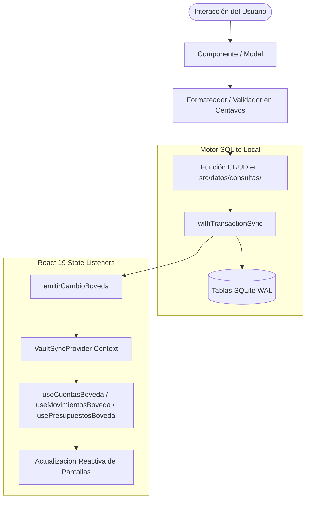

# Informe Técnico y Arquitectónico: Kyrara Gez (Local Vault)
**Documento para Análisis de Modelos de Lenguaje / IA**  
*Fecha de generación: Octubre 2026*  
*Versión de la aplicación: 1.0.4*  
*Ecosistema: Expo SDK 57 (React Native 0.86, React 19)*  

---

## 1. Resumen Ejecutivo y Filosofía del Sistema

**Kyrara Gez** es una aplicación móvil de gestión financiera personal y control presupuestario de alta gama (*fintech premium*), diseñada bajo el paradigma **Local-First (Offline-First)** y de **Privacidad Absoluta (Zero-Telemetry)**.

### Principios Rectores de Ingeniería:
1. **Soberanía del Dato (Local-First):** Toda la información financiera reside exclusivamente en el dispositivo del usuario en una base de datos local SQLite bajo modo WAL (*Write-Ahead Logging*). No existen servidores externos obligatorios ni telemetría que exponga datos personales.
2. **Aritmética Financiera Entera (Centavos):** Para erradicar errores de precisión de punto flotante en JavaScript (`0.1 + 0.2 !== 0.3`), todos los montos se almacenan y calculan internamente como números enteros en centavos (`$150.50` = `15050` centavos).
3. **Reactividad por Eventos Desacoplada:** El estado global no depende de bibliotecas pesadas como Redux o MobX; utiliza un bus reactivo nativo (`VaultSyncProvider` / `emitirCambioBoveda`) acoplado a hooks de React 19 (`useSyncExternalStore`), lo que asegura renderizados quirúrgicos y óptimo rendimiento a 60/120 FPS.
4. **Diseño Cyber-Luxury / Glassmorphism:** Estética visual oscura contemporánea (`#0B0F10`), acentos neón violeta y cian, efectos de vidrio esmerilado con gradientes sutiles y retroalimentación háptica táctil en cada interacción.
5. **Doble Capa de Nomenclatura (Español / Inglés):** Código modular escrito en español técnico estandarizado, con exportación de alias en inglés en cada módulo para garantizar interoperabilidad completa con herramientas, tests y bibliotecas externas.

---

## 2. Pila Tecnológica (Tech Stack)

| Componente | Tecnología | Versión | Propósito / Características |
| :--- | :--- | :--- | :--- |
| **Framework Base** | Expo SDK | `~57.0.30` | Ecosistema gestionado con CNG (*Continuous Native Generation*). |
| **Librería UI Core** | React / React Native | `19.2.3` / `0.86.3` | Motor de componentes con concurrencia y reconciliador moderno. |
| **Enrutador / Navegación** | Expo Router | `~57.0.26` | Enrutamiento basado en sistema de archivos (`src/app/`). |
| **Base de Datos** | `expo-sqlite` | `~57.0.4` | SQLite nativo en modo WAL con soporte de transacciones síncronas. |
| **Seguridad Biométrica** | `expo-local-authentication`| `~57.0.3` | Huella dactilar, FaceID y Android BiometricPrompt nativos. |
| **Sistema de Archivos** | `expo-file-system/legacy` | `~57.0.7` | Lectura/escritura local de archivos JSON y CSV. |
| **Compartición / Backup** | `expo-sharing` | `~57.0.23` | Diálogo nativo para guardar o enviar respaldos y hojas Excel. |
| **Splash Screen** | `expo-splash-screen` | `~57.0.10` | Inicio nativo oscuro sin destellos blancos ni logos genéricos. |
| **Tipografía** | `@expo-google-fonts/inter` | `^0.4.2` | Fuente Inter (pesos 400, 500, 600, 700). |
| **Iconografía** | `@expo/vector-icons` | `^15.0.2` | MaterialIcons para consistencia visual completa. |
| **Respuesta Háptica** | `expo-haptics` | `~57.0.3` | Vibraciones micro-táctiles (selección, éxito, advertencia, error). |

---

## 3. Arquitectura del Proyecto y Directorios

El código está estructurado en capas bien delimitadas con responsabilidad única:

```
c:\dev\Kyrara-Gez\
├── app.json                     # Manifiesto de Expo, plugins nativos y configuración de Splash
├── package.json                 # Dependencias bloqueadas para Expo SDK 57
├── tsconfig.json                # Configuración de TypeScript con alias @/* hacia src/*
├── assets/                      # Iconos, logo oficial (1024x1024) y splash screen
└── src/
    ├── app/                     # Capa de Enrutamiento (Expo Router)
    │   ├── _layout.tsx          # Layout raíz: fuentes, Splash, Bóveda, LockScreen
    │   ├── index.tsx            # Redirección inicial hacia (tabs)
    │   └── (tabs)/              # Navegación por pestañas (barra inferior)
    │       ├── _layout.tsx      # Barra de navegación persistente con insets seguros
    │       ├── index.tsx        # Ruta tab: Inicio (Dashboard)
    │       ├── movimientos.tsx  # Ruta tab: Movimientos
    │       ├── presupuestos.tsx # Ruta tab: Presupuestos
    │       ├── cuentas.tsx      # Ruta tab: Cuentas y Categorías
    │       ├── ajustes.tsx      # Ruta oculta: Ajustes (mantiene la barra inferior)
    │       └── nuevo.tsx        # Ruta oculta: Acceso a nuevo movimiento
    ├── pantallas/               # Vistas y componentes de pantalla
    │   ├── inicio/              # PantallaInicio.tsx (Métricas, resumen, accesos rápidos)
    │   ├── movimientos/         # PantallaMovimientos, Formulario, Detalle, Filtros
    │   ├── presupuestos/        # PantallaPresupuestos, Tarjetas de progreso, Modales
    │   ├── cuentas/             # PantallaCuentas, Pestañas Cuentas/Categorías, Modales
    │   └── ajustes/             # PantallaAjustes, PestanaAjustes, PIN, Restaurar, Backup
    ├── datos/                   # Capa de Persistencia y Lógica de Negocio
    │   ├── conexion.ts          # Singleton de apertura de base de datos SQLite
    │   ├── esquema.ts           # DDL: creación de tablas, índices y PRAGMA WAL
    │   ├── semillas.ts          # Datos iniciales (categorías y cuenta por defecto)
    │   ├── tipos.ts             # Definición de tipos TypeScript para todo el dominio
    │   ├── sincronizacion.tsx   # Contexto y emisor de eventos de reactividad
    │   ├── hooks.ts             # Custom hooks reactivos (useCuentasBoveda, etc.)
    │   └── consultas/           # Funciones CRUD puras por entidad
    │       ├── analiticas.ts    # Agregaciones, desgloses y flujo de caja mensual
    │       ├── cuentas.ts       # CRUD de cuentas, balance y protección de borrado
    │       ├── categorias.ts    # CRUD de categorías de gasto e ingreso
    │       ├── movimientos.ts   # CRUD de transacciones con recálculo atómico de saldo
    │       ├── presupuestos.ts  # Control de límites, alertas y clonación de periodos
    │       ├── respaldos.ts     # Serialización JSON y exportación CSV/Excel con BOM UTF-8
    │       └── seguridad.ts     # Configuración de PIN y flags biométricos en SQLite
    └── compartido/              # Componentes de UI, temas y utilidades
        ├── tema/                # Tokens de diseño (colores.ts, tipografia.ts)
        ├── componentes/         # EncabezadoSuperior, TarjetaVidrio, BotonBrillante, etc.
        └── utilidades/          # Formateo de moneda, fecha, parser de dinero y hápticos
```

---

## 4. Modelo de Datos Relacional (SQLite)

La base de datos utiliza cinco tablas relacionales normalizadas:

### 4.1. `accounts` (Cuentas Financieras)
*Almacena las billeteras, cuentas bancarias o cajas de seguridad del usuario.*
- `id` (TEXT, PK): Identificador UUID o timestamp único.
- `name` (TEXT, NOT NULL): Nombre descriptivo (ej: *"Billetera Principal"*, *"Banco Itaú"*).
- `type` (TEXT, NOT NULL): Enum `'CASH' | 'BANK' | 'PREPAID' | 'VAULT'`.
- `currency` (TEXT, DEFAULT `'UYU'`): Código de moneda ISO 4217.
- `initial_balance` (INTEGER, DEFAULT 0): Saldo inicial en centavos.
- `current_balance` (INTEGER, DEFAULT 0): Saldo actual en centavos (actualizado por transacciones).
- `icon` (TEXT): Nombre de icono de MaterialIcons.
- `color` (TEXT): Código hexadecimal representativo.
- `is_archived` (INTEGER, DEFAULT 0): Bandera booleana (0 o 1) para archivado suave.
- `created_at` (INTEGER, NOT NULL): Timestamp en milisegundos de creación.

### 4.2. `categories` (Categorías de Clasificación)
*Clasifica los ingresos y egresos.*
- `id` (TEXT, PK): Identificador único.
- `name` (TEXT, NOT NULL): Nombre (ej: *"Alimentación"*, *"Salario"*, *"Transporte"*).
- `flow_type` (TEXT, NOT NULL): Enum `'EXPENSE' | 'INCOME'`.
- `icon` (TEXT, NOT NULL): Icono de MaterialIcons.
- `color` (TEXT, NOT NULL): Color asignado.
- `is_system` (INTEGER, DEFAULT 0): Si es `1`, fue provista por el sistema (protegida).

### 4.3. `transactions` (Movimientos Contables)
*Registra cada operación financiera.*
- `id` (TEXT, PK): Identificador único.
- `amount` (INTEGER, NOT NULL): Monto en centavos (siempre positivo).
- `type` (TEXT, NOT NULL): Enum `'EXPENSE' | 'INCOME' | 'TRANSFER'`.
- `source_account_id` (TEXT, NOT NULL, FK `accounts.id`): Cuenta origen.
- `target_account_id` (TEXT, NULL, FK `accounts.id`): Cuenta destino (solo para transferencias).
- `category_id` (TEXT, NULL, FK `categories.id`): Categoría del gasto o ingreso.
- `date` (INTEGER, NOT NULL): Timestamp de la transacción.
- `note` (TEXT, NULL): Nota u observación adicional.
- `payee` (TEXT, NULL): Beneficiario, comercio o pagador.
- `tags` (TEXT, NULL): Etiquetas opcionales separadas por coma.

### 4.4. `budgets` (Presupuestos Mensuales)
*Topes de gasto definidos por categoría y mes.*
- `id` (TEXT, PK): Identificador único.
- `category_id` (TEXT, NOT NULL, FK `categories.id`): Categoría presupuestada.
- `monthly_limit` (INTEGER, NOT NULL): Límite mensual en centavos.
- `period` (TEXT, NOT NULL): Cadena de periodo con formato `'YYYY-MM'`.
- `alert_threshold` (REAL, DEFAULT 0.90): Umbral de advertencia porcentual (ej: 90%).

### 4.5. `settings` (Configuración Clave-Valor)
*Almacena parámetros de bóveda.*
- `key` (TEXT, PK): Clave de configuración (ej: `'has_pin'`, `'pin_code'`, `'biometrics_enabled'`).
- `value` (TEXT, NOT NULL): Valor serializado en texto o JSON.

---

## 5. Descripción Exhaustiva de Pantallas y Flujos Funcionales

### 5.1. Inicialización y Bloqueo (`RootLayout` & `PantallaBloqueo`)
- **Control de Splash:** Previene el cierre automático de la pantalla de inicio nativa hasta que las fuentes tipográficas Inter y la base de datos SQLite estén inicializadas.
- **Bóveda de Seguridad:** Si el usuario tiene habilitado un PIN y la opción `requirePinOnStartup` es verdadera, se renderiza la `PantallaBloqueo` de inmediato.
- **Desbloqueo Biométrico:** Llama a `LocalAuthentication.authenticateAsync()` con fallback al teclado numérico en pantalla si falla o si el usuario prefiere ingresar su PIN.

### 5.2. Pantalla 1: Inicio / Tablero Principal (`PantallaInicio`)
- **Cabecera Dinámica (`EncabezadoSuperior`):** Muestra el logotipo de Kyrara Gez, insignia de la sección actual, píldora con el periodo en curso (`"Oct 2026"`) y botón de acceso a Ajustes.
- **Tarjeta Héroe "Dinero Disponible":**
  - Muestra la suma consolidada de todos los saldos de cuentas no archivadas.
  - Botón de alternancia de privacidad (icono de ojo) para ocultar o revelar las cifras (`••••••`).
- **Tira de Métricas de Flujo de Caja:**
  - **Ingresos:** Total acumulado del mes con color verde esmeralda (`#00e676`).
  - **Gastos:** Total de egresos del mes en color rojo/coral (`#ff5252`).
  - **Superávit / Déficit:** Diferencia neta con indicación visual de ahorro.
- **Botones de Operación Rápida:** Accesos directos para registrar *Gasto*, *Ingreso* o *Traspaso* que disparan el formulario modal sin salir del tablero.
- **Carrusel / Cuadrícula "Mis Cuentas":** Tarjetas compactas por cada cuenta mostrando nombre, saldo y tipo (Físico, Banco, Virtual o Bóveda).
- **Lista "Últimos Movimientos":** Muestra los últimos 4 registros del mes con posibilidad de tocar cualquiera de ellos para ver su comprobante detallado.

### 5.3. Pantalla 2: Movimientos / Historial (`PantallaMovimientos`)
- **Buscador en Tiempo Real:** Filtra instantáneamente por texto en la nota, nombre de categoría, beneficiario o cuenta.
- **Barra de Filtros por Píldoras:** Alterna entre *Todos*, *Gastos*, *Ingresos* y *Traspasos*.
- **Tarjeta de Resumen de la Vista:** Muestra el total de ingresos, gastos y balance neto resultante del conjunto filtrado actual.
- **Agrupación Cronológica:** Las transacciones se agrupan automáticamente bajo títulos dinámicos: *"Hoy"*, *"Ayer"* o fecha formateada (*"19 de Oct"*).
- **Fila de Movimiento (`FilaMovimiento`):** Presenta el icono y color de la categoría, nombre, beneficiario, cuenta asociada y monto formateado en centavos con signo y color respectivo.
- **Modal de Detalle (`ModalDetalleMovimiento`):**
  - Vista estilo comprobante / recibo fiscal moderno.
  - Desglose completo de fecha, hora, cuenta origen, cuenta destino, categoría y nota.
  - Identificador único copiable al portapapeles.
  - Opción de eliminación con alerta destructiva y reversión atómica automática en el saldo de la cuenta.

### 5.4. Pantalla 3: Presupuestos (`PantallaPresupuestos`)
- **Selector de Periodo:** Navegación mes a mes con recálculo automático de métricas históricas o futuras.
- **Tarjeta Progreso General (`TarjetaProgresoPresupuesto`):**
  - **Barra de Progreso:** Porcentaje global del presupuesto consumido.
  - **Indicador de Ritmo del Mes (Pace Indicator):** Compara el porcentaje de días transcurridos contra el porcentaje de dinero gastado, alertando si el gasto va más rápido que el mes.
  - **Cálculo de Disponible Diario:** Calcula cuánto dinero por día puede gastar el usuario en los días restantes del mes para mantenerse dentro del presupuesto.
- **Ordenamiento Inteligente:** Permite ordenar las categorías por *Mayor % gastado*, *Mayor límite* o *Nombre alfabético*.
- **Tarjetas por Categoría (`TarjetaCategoriaPresupuesto`):**
  - Muestra límite, gastado, remanente y barra de progreso.
  - Estado visual adaptativo: Verde/Normal, Amarillo (>= 90% del límite) y Rojo (Superado / Overbudget).
- **Herramientas de Gestión:**
  - **Crear Presupuesto:** Modal para asignar tope mensual a una categoría aún no presupuestada.
  - **Clonar Presupuesto:** Copia automáticamente todos los límites del mes anterior al mes actual en una sola pulsación.
  - **Sembrar Recomendados:** Sugerencias automáticas basadas en promedios de gasto.

### 5.5. Pantalla 4: Cuentas y Categorías (`PantallaCuentas`)
- **Conmutador Segmentado:** Pestaña superior para cambiar entre la gestión de *Cuentas* y la de *Categorías*.
- **Sub-pestaña Cuentas (`PestanaCuentas`):**
  - Lista de todas las cuentas configuradas con saldo, icono y tipo.
  - Al pulsar una cuenta se abre el modal de edición.
- **Modal de Ajustar / Crear Cuenta (`ModalCuenta`):**
  - Configuración de nombre, tipo de cuenta (`CASH`, `BANK`, `PREPAID`, `VAULT`) y saldo actual o inicial.
  - **Acción de Eliminar:** Botón de icono de papelera en la barra superior del modal.
  - **Protección de Última Cuenta:** Impide eliminar una cuenta si es la única existente en el sistema para evitar romper la integridad referencial de transacciones.
  - **Borrado Atómico:** Si se autoriza la eliminación, SQLite borra dentro de una transacción todas las transacciones vinculadas a esa cuenta y luego la cuenta misma.
- **Sub-pestaña Categorías (`PestanaCategorias`):**
  - Visualización separada de categorías de *Gasto* y de *Ingreso*.
  - Modal para crear nuevas categorías con selección de paleta de color e icono de MaterialIcons.

### 5.6. Pantalla 5: Ajustes y Respaldo (`PantallaAjustes` / `PestanaAjustes`)
*Integrada dentro del árbol de navegación con barra inferior visible y botón superior de retroceso.*
- **Sección Seguridad:**
  - Configuración y cambio de código PIN de 4 dígitos (`ModalPin`).
  - Habilitación / Deshabilitación de acceso biométrico (Huella / FaceID).
  - Interruptor para exigir PIN al abrir la aplicación.
- **Gestión de Datos Locales (Respaldo y Recuperación):**
  - **Crear Respaldo JSON:** Serializa todas las tablas de la base de datos (cuentas, categorías, transacciones, presupuestos y ajustes) en un archivo `.json` formateado y abre el menú nativo del teléfono (`expo-sharing`) para guardarlo en la carpeta de Documentos, Google Drive, WhatsApp o enviarlo por correo.
  - **Restaurar Datos:** Permite abrir el selector de documentos (`expo-document-picker`), validar la estructura del JSON y reemplazar de manera atómica todos los datos de la app.
  - **Exportar a Excel (CSV):** Genera un archivo `.csv` optimizado con encabezados legibles y codificación UTF-8 con marca de orden de bytes (`\uFEFF`), permitiendo que Microsoft Excel, Numbers o Google Sheets lo abran sin caracteres corruptos ni problemas de puntuación.
  - **Restablecer Base de Datos:** Opción de reseteo completo a valores de fábrica bajo doble confirmación destructiva.
- **Acerca de:** Créditos, versión y declaración de política Local-First.

### 5.7. Flujo de Registro de Transacción (`FormularioMovimiento`)
- **Selector de Tipo de Movimiento:** Botones para alternar entre *Gasto*, *Ingreso* y *Traspaso*.
- **Entrada Numérica Inteligente con Máscara:** El usuario escribe números y el formateador (`formatMoneyInput`) los procesa como centavos de derecha a izquierda (ej: escribir `1` `5` `0` `0` genera `$ 15,00`), evitando caracteres inválidos.
- **Selectores de Cuenta:** Origen y Destino (en traspasos).
- **Selector de Categoría:** Cuadrícula con iconos y nombres.
- **Selector de Fecha Nativo (`ModalSelectorFecha`):** Calendario emergente con atajos rápidos para *"Hoy"* y *"Ayer"*.
- **Campos de Beneficiario y Nota:** Entradas de texto libres para detalle opcional.
- **Ejecución de Guardado:** Validación de saldo, inserción en la tabla `transactions`, actualización sincronizada de `current_balance` en `accounts`, y emisión de evento de sincronización para actualizar el resto de las pantallas.

---

## 6. Sistema Reactivo y Flujo de Datos



### Características Clave de la Reactividad:
1. **Consistencia Transaccional:** Cada escritura en la base de datos se ejecuta mediante `db.withTransactionSync()`. Si alguna operación secundaria falla (por ejemplo, actualizar el saldo de la cuenta tras insertar una transacción), se hace rollback total automático.
2. **Propagación Instantánea:** Inmediatamente después de completarse la transacción de SQLite, se invoca `emitirCambioBoveda()`.
3. **Escuchadores Desacoplados:** Los componentes suscritos mediante `useCuentasBoveda` o `useMovimientosBoveda` vuelven a consultar la base de datos local y refrescan su estado local en milisegundos sin necesidad de refrescar la pantalla manualmente.

---

## 7. Sistema de Diseño y Tokens UI

### 7.1. Paleta de Colores (`src/compartido/tema/colores.ts`)
- **Fondo Base (`superficieBase`):** `#0B0F10` (Negro absoluto ligeramente azulado).
- **Superficies y Tarjetas:**
  - `superficie`: `#101415`
  - `superficieContenedorBajo`: `#181c1d`
  - `superficieContenedor`: `#1c2021`
  - `superficieContenedorAlto`: `#272b2c`
- **Acentos de Marca (Cyber-Neon):**
  - `primarioContenedor` / `primario`: `#8A4FFF` / `#D1BCFF` (Violeta vibrante).
  - `secundario` / `secundarioContenedor`: `#8be0e2` / `#004f51` (Cian tecno).
- **Flujo de Dinero (Semántica Financiera):**
  - `cashflowIncome`: `#00e676` (Verde esmeralda para ingresos).
  - `cashflowExpense`: `#ff5252` (Rojo coral para egresos).
  - `cashflowTransfer`: `#8A4FFF` (Violeta para traspasos entre cuentas).
- **Bordes de Vidrio (Glassmorphism):**
  - `borderGlass`: `rgba(255, 255, 255, 0.08)`
  - `borderGlassHigh`: `rgba(255, 255, 255, 0.15)`

### 7.2. Jerarquía Tipográfica (`src/compartido/tema/tipografia.ts`)
- Basada íntegramente en la familia **Inter**.
- Variantes estructuradas:
  - `displayHeroMobile`: `fontSize: 32`, `fontWeight: '700'` (Para el saldo principal).
  - `headlineSm`: `fontSize: 18`, `fontWeight: '700'` (Títulos de sección).
  - `numericTable`: `fontSize: 14`, `fontWeight: '600'` con alineación tabular para cifras.
  - `labelCaps`: `fontSize: 10`, `fontWeight: '700'`, `textTransform: 'uppercase'`, `letterSpacing: 0.8` (Píldoras e insignias).
  - `bodySm`: `fontSize: 13`, `fontWeight: '400'` (Textos descriptivos y notas).

---

## 8. Consideraciones de Seguridad y Robustez

1. **Inyección SQL Imposible:** Todas las consultas a SQLite utilizan sentencias parametrizadas (`?`) en lugar de interpolación de cadenas.
2. **Sin Fuga de Datos (Data Leaks):** No se integran SDKs de terceros de analítica (tipo Google Analytics, Firebase o Meta Pixel).
3. **Resiliencia ante Cierres Forzosos:** Gracias al modo `PRAGMA journal_mode = WAL`, la base de datos no se corrompe ante cierres abruptos o apagones de batería durante una escritura.
4. **Respaldos Portables y Humanos:** El formato de respaldo en JSON es completamente transparente, portable y legible por humanos o herramientas externas.
5. **Excel Compatible:** El exportador CSV utiliza el prefijo UTF-8 Byte Order Mark (`\uFEFF`), lo que garantiza que Microsoft Excel abra los archivos en español sin requerir asistentes de importación de texto.

---

## 9. Conclusión del Análisis

**Kyrara Gez** es un ejemplo canónico de desarrollo de vanguardia en React Native / Expo:
- Resuelve la fragmentación de estado mediante persistencia directa en SQLite con sincronización por eventos.
- Elimina los errores de redondeo de divisas con una arquitectura entera en centavos.
- Brinda una experiencia de usuario fluida, elegante y respetuosa de la privacidad, manteniendo un código limpio, desacoplado y estrictamente tipado.
